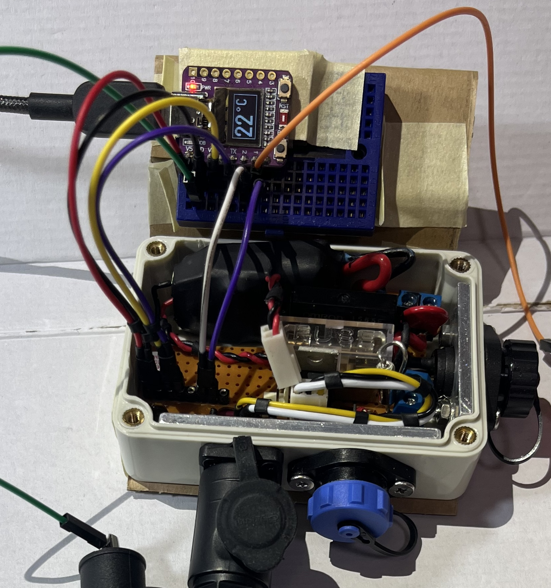

# Project Kolibrie

  
  

This is the realization and extension of [Project Hummingbird](https://github.com/AlexHentschel/hummingbird). 

## Setup
* We are working with a generic ESP32-C3 developer board, sold on Chinese e-commerce platforms. On boot-up, the board displays 'Abrobot' on its built-in screen. I had the most success finding documentation about this developer board when searching for "Abrobot ESP32 C3 OLED Shield".
  - https://github.com/zhuhai-esp/ESP32-C3-ABrobot-OLED (identifies the board as `airm2m_core_esp32c3`)
  - https://emalliab.wordpress.com/2025/02/12/esp32-c3-0-42-oled/ (lots of details that the author of the article still struggled with worked out of the box for me)
* Code is written in C / C++
* I have used [pioarduino](https://github.com/pioarduino) (a fork of [PlatformIO](https://platformio.org/)) as a Visual Studio Code [VS Code] extension ([tutorial](https://randomnerdtutorials.com/vs-code-pioarduino-ide-esp32/)). It is important to note that for our hardware (ESP32-C3), we require the ESP32 Arduino Core (version 3). The [pioarduino](https://github.com/pioarduino) fork was initially created to support the newer ESP32-C3 processors — though by now they seem to also be supported by [PlatformIO](https://platformio.org/) (not tested).
* To power the microcontroller independently of a computer, I used an old 5V / 850mA USB power adapter. ⚠️ Always ensure your power source is stable and within rated input range (6-21 V for the Arduino Nano ESP32).
* We are switching a 110V AC 50Hz load using:
   * Safety fuse on the AC main line
   * OMRON G3MB-202P Solid State Relay (rated for switching up to 240V AC @ 2A, requiring 5V input).
   * The GPIO pins of the microcontroller operate at 3.3V. Therefore, we use the GPIO pin to switch an IRL530 (N-MOSFET), which in turn switches the 5V input for the Omron Solid State Relay.

	
Version 1 ran successfully during winter 2025/26.

